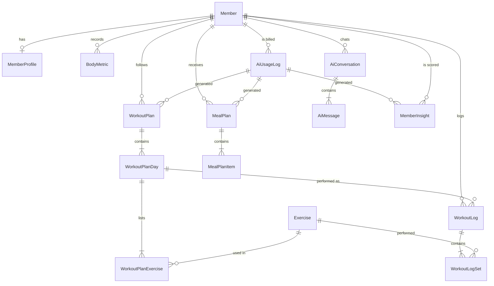
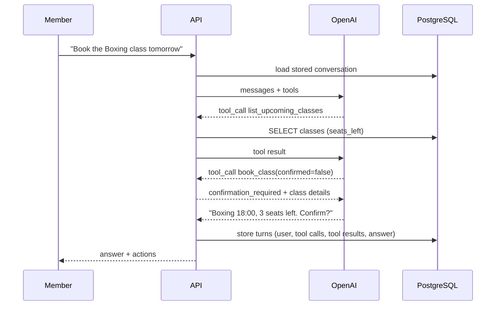

# AI coach and fitness domain

This document describes the second iteration of the AI features and the fitness tables added with
migration `20261125090000_fitness_domain_and_ai`.

Before this change the AI was a single `POST /api/ai/chat` endpoint: a fixed system prompt, no
access to the gym's data (it could not tell a member the real price of a package or whether a class
had seats), no history, and no idea of what it cost. Now OpenAI is used where it adds something a
plain CRUD screen cannot, and **every number that matters is computed by the server, not the
model**.

## Data model (14 new tables)

| Table | Purpose | Invariants in the database |
|---|---|---|
| `MemberProfile` | goal, experience, activity level, days/week, injuries, dietary restrictions (1-1 with `Member`) | height 100-250 cm, 1-7 days, 15-240 min |
| `BodyMetric` | weight, body fat, muscle mass, waist, resting HR over time | physiological ranges (CHECK) |
| `Exercise` | exercise library; AI plans may only reference it | unique name; `ON DELETE RESTRICT` from plans and logs |
| `WorkoutPlan` → `WorkoutPlanDay` → `WorkoutPlanExercise` | weekly split, days, exercises with sets/reps/rest | **partial unique index: one `active` plan per member**; active ⇒ `activated_at`; sets 1-10; unique `(day, position)` |
| `WorkoutLog` → `WorkoutLogSet` | what was actually done | RPE 1-10; unique `(log, exercise, set_number)` |
| `MealPlan` → `MealPlanItem` | meals per day with calories and macros | non-negative macros, 1-7 days |
| `AiConversation` → `AiMessage` | stored chat, including tool calls and tool results | cascade delete |
| `AiUsageLog` | one row per OpenAI request: feature, model, tokens, estimated cost, latency, error | non-negative counters |
| `MemberInsight` | churn risk score, explanation, recommended action, outreach message | score 0-100 |

Generated rows keep `ai_usage_id`, so any plan or insight can be traced to the request (and the
cost) that produced it.

## AI features

All OpenAI calls go through [`services/ai/client.ts`](../backend/src/services/ai/client.ts):
per-member daily quota (`AI_MEMBER_DAILY_LIMIT`, `429 AI_QUOTA_EXCEEDED`), token and cost
accounting in `AiUsageLog`, timeout + SDK retries, and upstream failures mapped to
`502 AI_UPSTREAM_ERROR` (also logged with `status = error`).

### 1. Chatbot with tool calling — `POST /api/ai/chat`

| Tool | Who | What it does |
|---|---|---|
| `list_packages` | everyone | packages on sale with real prices |
| `list_upcoming_classes` | everyone | classes in the next N days, free seats |
| `get_my_membership` | members | memberships and days left |
| `get_my_bookings` | members | upcoming bookings and waitlist positions |
| `get_my_progress` | members | profile, measurements, training and visits in the last 30 days, active plan |
| `book_class` | members | books through `bookingService` (same seat counter, waitlist and locks as the REST API) |
| `cancel_booking` | members | cancels through `bookingService` (frees the seat, promotes the waitlist) |

Safety: write tools take a `confirmed` flag and the system prompt requires an explicit "yes" from
the member before `confirmed=true`; tool arguments are validated with zod; tool errors are
returned to the model as data (it explains them) instead of failing the request; the number of
tool rounds is capped (`AI_MAX_TOOL_ROUNDS`, the last round forces a text answer); clients still
cannot send a `system` message.

### 2. Workout plan generator — `POST /api/ai/workout-plans/generate`

Structured Outputs with a JSON schema built **per request**: `exercise_id` is an `enum` of the
exercises allowed for the member's level, so the model cannot reference an exercise that does not
exist. The answer is then normalised (days renumbered and cut to `training_days_per_week`,
duplicates removed, sets/rest clamped to the CHECK ranges) and saved as a `draft` in one nested
insert. `POST /api/fitness/workout-plans/{id}/activate` archives the previous plan in the same
transaction; the partial unique index guarantees one active plan even under concurrent requests.

### 3. Meal plan generator — `POST /api/ai/meal-plans/generate`

The server computes the targets: Mifflin-St Jeor BMR × activity factor, −20 % for fat loss / +10 %
for muscle gain, protein 1.4-2.0 g/kg, fat 25 % of calories, carbs the rest, never below
1200 kcal. The model only distributes Vietnamese foods within those numbers and must respect
dietary restrictions. The response reports each day's totals and deviation from the target.
Missing inputs return `422 NUTRITION_DATA_MISSING` with the list of fields.

### 4. Progress report — `POST /api/ai/progress-report`

SQL computes weekly workouts/minutes/RPE (8 weeks), volume per muscle group (30 days), visits,
body composition change (90 days) and adherence to the active plan (14 days). The model receives
only these statistics and returns `headline`, `summary`, `wins`, `concerns`, `recommendations`.

### 5. Churn insights for staff — `POST /api/ai/insights/churn`, `GET /api/ai/insights`

For members with an active membership, SQL computes: days since last visit, visits in the last 14
days vs the 28 days before, days until expiry, cancelled bookings, logged workouts, tenure. A
deterministic heuristic (`fitness/churn.ts`) gives a baseline score; the model returns a score,
an explanation, an action for staff and a ready-to-send message per member (batched, `member_id`
is an enum of the analysed ids). Stored score = 70 % model + 30 % baseline, so one odd answer
cannot mark a clearly inactive member as low risk; the baseline is stored too. The worker can run
it periodically (`AI_CHURN_JOB_INTERVAL_HOURS`).

### Cost dashboard — `GET /api/ai/usage`

Requests, errors, tokens, estimated USD cost and average latency per feature, cost per day, and the
members using the most.

## Configuration

| Variable | Default | |
|---|---|---|
| `OPENAI_API_KEY` | — | without it AI endpoints return `503 AI_NOT_CONFIGURED`; the rest of the app works |
| `OPENAI_MODEL` | `gpt-4o-mini` | any chat model with Structured Outputs |
| `OPENAI_TIMEOUT_MS` | `30000` | |
| `AI_MEMBER_DAILY_LIMIT` | `30` | OpenAI requests per member per UTC day, `0` = unlimited |
| `AI_MAX_TOOL_ROUNDS` | `4` | tool-calling rounds per chat message |
| `AI_CHURN_JOB_INTERVAL_HOURS` | `0` | worker churn job, `0` = off |

## Tests

* `tests/unit/fitness-ai.test.ts`: nutrition maths, churn heuristic, plan normalisation, cost
  estimate, strict tool / response schemas, history trimming.
* `tests/integration/ai-fitness.test.ts` (real PostgreSQL, scripted fake OpenAI in
  `tests/helpers/openai.ts`): tool calling over real data, booking via chat (seat counter checked),
  conversation storage and replay, ownership, quota, upstream failure, plan generation limited to
  library exercises, one-active-plan rule, meal targets, progress statistics, churn scoring and
  listing, usage report, fitness CRUD validation.
